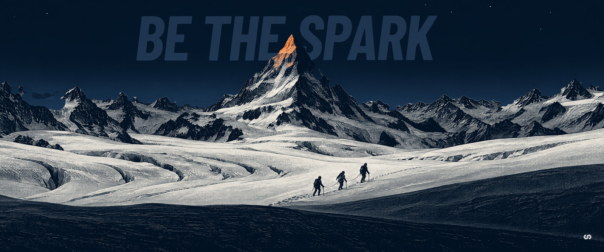
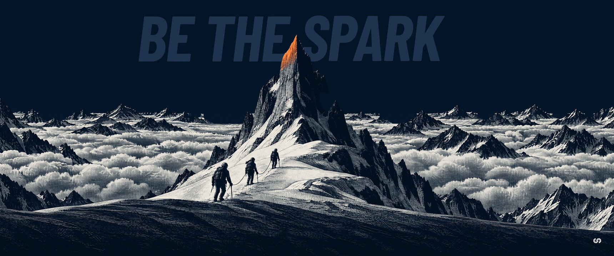
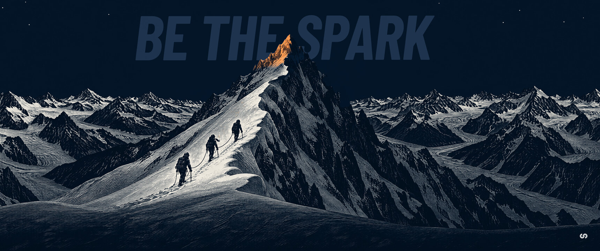
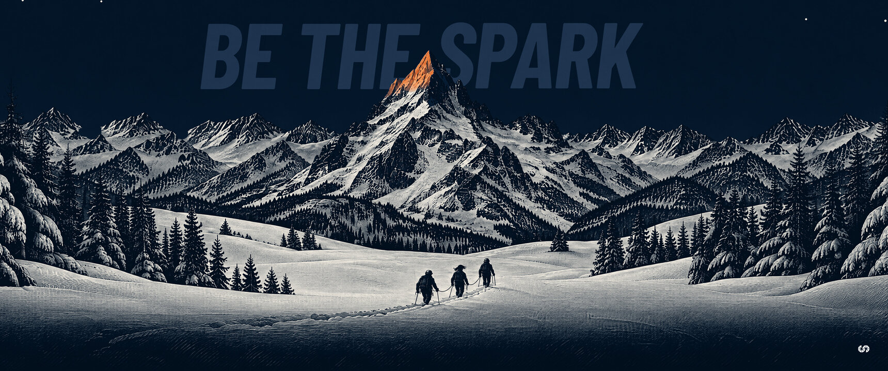

# SF Be the Spark

An [Omarchy](https://omarchy.org/) theme built around the SparkFabrik "Be the Spark" wallpapers. Four night scenes engraved in navy and cream: three climbers roped together, a mountain, and BE THE SPARK printed in the sky one tone lighter. The only orange is the lit summit, the spark.



The colors come from the SparkFabrik design system (version v2026.11.11.4): navy surfaces, cream ink and orange as the one warm accent, the same light as the summit.

Requires **Omarchy 4**. The theme ships only `colors.toml` for its colors, so the terminal, the Omarchy shell (bar, notifications, launcher, lock screen), Hyprland borders, Neovim, VS Code, btop and the other themed apps are all generated from the same palette.

## Install

```bash
omarchy theme install https://github.com/stefanomainardi/sf-be-the-spark
```

The theme is cloned into `~/.config/omarchy/themes/sf-be-the-spark` and applied. To switch back to it later, run `omarchy theme set sf-be-the-spark` or pick it from the theme menu.

To update:

```bash
omarchy theme update
```

## Backgrounds

Four scenes, approved by SparkFabrik in October and November 2026. Cycle them with `omarchy theme bg next` or pick one from the background switcher.

| File                 | Scene                                                |
| -------------------- | ---------------------------------------------------- |
| `1-prima-luce.jpg`   | Prima luce: the roped party crosses a glacier        |
| `2-primo-raggio.jpg` | Primo raggio: a granite spire above a sea of clouds  |
| `3-la-cresta.jpg`    | La cresta: the party climbs a long, sharp ridge      |
| `4-neve-fresca.jpg`  | Neve fresca: a trail in fresh snow among the firs    |







The default backgrounds are 3440x1440, composed by SparkFabrik for 21:9 ultrawide displays.

### Other screen ratios

Omarchy scales the image to fill the screen, so on a 16:9 or 16:10 display the sides of the 21:9 version are cropped. `backgrounds-extra/` has versions composed for those screens:

| Folder                     | Size      | For                              |
| -------------------------- | --------- | -------------------------------- |
| `backgrounds-extra/16x9/`  | 3840x2160 | 16:9 displays (1080p, 1440p, 4K) |
| `backgrounds-extra/16x10/` | 3840x2400 | 16:10 displays and laptops       |

To use them, copy a set into your own background folder for this theme and set one:

```bash
mkdir -p ~/.config/omarchy/backgrounds/sf-be-the-spark
cp ~/.config/omarchy/themes/sf-be-the-spark/backgrounds-extra/16x9/*.jpg \
   ~/.config/omarchy/backgrounds/sf-be-the-spark/
omarchy theme bg set ~/.config/omarchy/backgrounds/sf-be-the-spark/1-prima-luce-16x9.jpg
```

Files in that folder join the same cycle as the 21:9 ones and survive theme updates.

## Boot and unlock screen

The theme ships the SparkFabrik logo for the Plymouth boot screen (`unlock.png`). Apply it with:

```bash
omarchy plymouth set by theme sf-be-the-spark
```

The theme also appears in the unlock screen picker (`omarchy plymouth switcher`).

## Screensaver

The theme carries the SparkFabrik logo as screensaver art in `screensaver.txt`. Omarchy reads its screensaver art from one global file, so the theme includes a small `theme-set` hook that ties the art to the active theme. With the hook installed, this theme shows the Spark logo and other themes get the stock Omarchy logo back.

Install the hook once:

```bash
mkdir -p ~/.config/omarchy/hooks/theme-set.d
cp ~/.config/omarchy/themes/sf-be-the-spark/hooks/theme-set.d/screensaver-branding \
   ~/.config/omarchy/hooks/theme-set.d/
omarchy theme set sf-be-the-spark
```

Test it with `omarchy-launch-screensaver force` and press any key to dismiss it. If you already installed the same hook for the [Spark Omarchy](https://github.com/stefanomainardi/spark-omarchy) theme, you do not need to install it again.

## Palette

Every color is a token of the SparkFabrik design system, taken from its dark application theme.

| Role                     | Hex       | Design system token      |
| ------------------------ | --------- | ------------------------ |
| Background               | `#06172b` | Navy (`app-dark-bg`)     |
| Surface                  | `#0a1f37` | `app-dark-surface`       |
| Sunk background          | `#041a30` | `app-dark-sunk`          |
| Foreground               | `#eef2f6` | `app-dark-ink`           |
| Secondary text           | `#c9d3de` | Mist (`app-dark-ink2`)   |
| Accent, active border    | `#f36931` | Orange (`app-primary`)   |
| Inactive border          | `#1d3550` | `app-dark-bar-line`      |
| Selection                | `#0d2744` | `app-chrome-current`     |
| Muted                    | `#5d7186` | `app-dark-field-border`  |
| Red                      | `#ff8a8a` | `app-dark-error`         |
| Yellow                   | `#f7c56b` | `app-dark-warn`          |
| Green                    | `#7fdde3` | `app-dark-ok`            |
| Cyan                     | `#40c6cf` | Aqua                     |
| Blue                     | `#8cc8f2` | `app-dark-run`           |
| Magenta                  | `#cd0089` | Spark Purple (legacy)    |

Orange is kept for the active window and the accent, so there is one warm light on screen, like the summit in the wallpapers. The design system has no green: the "ok" status is aqua, and the terminal follows it. It has no magenta either, so magenta keeps the old Spark Purple.

## What is in here

| File                 | Role                                                                              |
| -------------------- | --------------------------------------------------------------------------------- |
| `colors.toml`        | The palette. Every generated app config comes from this file                      |
| `shell.lock.toml`    | Lock screen colors, overriding the `[lock]` section of the generated shell config |
| `icons.theme`        | GTK icon theme (`Yaru`, orange)                                                   |
| `keyboard.rgb`       | Backlight color for supported keyboards                                           |
| `preview.jpg`        | Thumbnail in the theme switcher                                                   |
| `unlock.png`         | Logo for the Plymouth boot screen                                                 |
| `preview-unlock.png` | Thumbnail in the unlock screen picker                                             |
| `screensaver.txt`    | Screensaver art                                                                   |
| `backgrounds/`       | 21:9 wallpapers                                                                   |
| `backgrounds-extra/` | 16:9 and 16:10 wallpapers, not in the default cycle                               |
| `hooks/theme-set.d/` | Optional hook that ties the screensaver art to the active theme                   |
| `docs/`              | Images for this README                                                            |

To change a color, edit `colors.toml` and run `omarchy theme set sf-be-the-spark`. Keep comments in `colors.toml` on their own line: Omawrite, the editor Omarchy ships, reads the file line by line and does not strip a trailing comment.

## Credits

Theme by Stefano Mainardi, built on the SparkFabrik design system. It shares its branding with [Spark Omarchy](https://github.com/stefanomainardi/spark-omarchy).

## License

The theme code and configuration are MIT licensed, see [LICENSE](LICENSE).

The SparkFabrik name, logo, the "Be the Spark" artwork and the wallpapers are property of SparkFabrik S.r.l. and are included here with permission. They are **not** covered by the MIT license and may not be reused to identify another product or organization. See [NOTICE](NOTICE).
