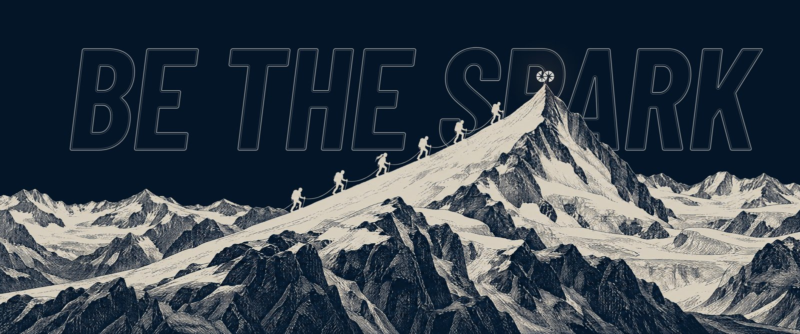
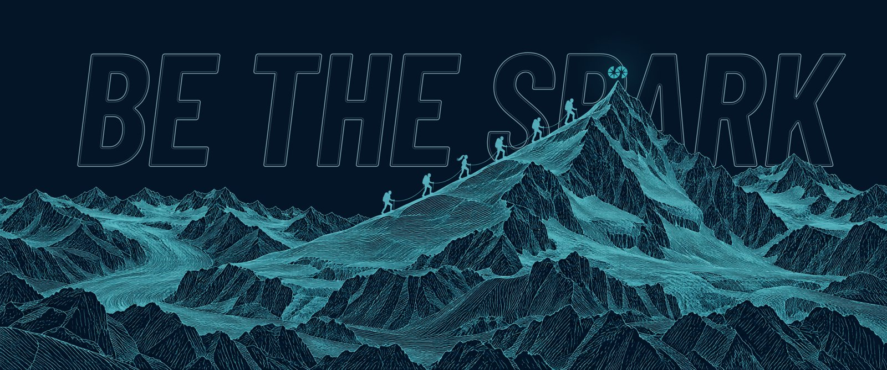
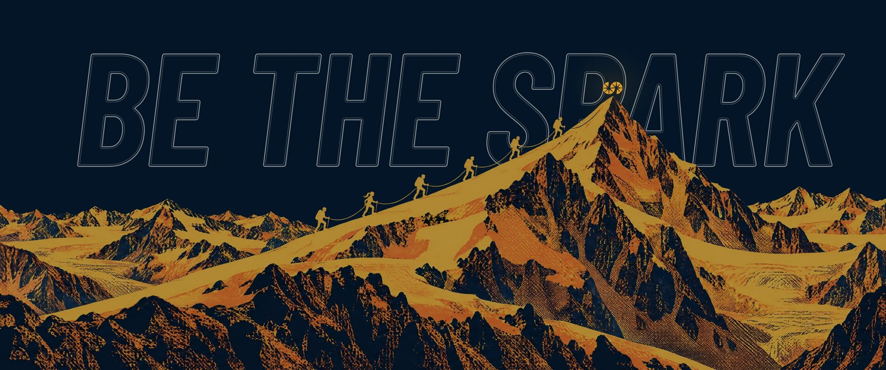
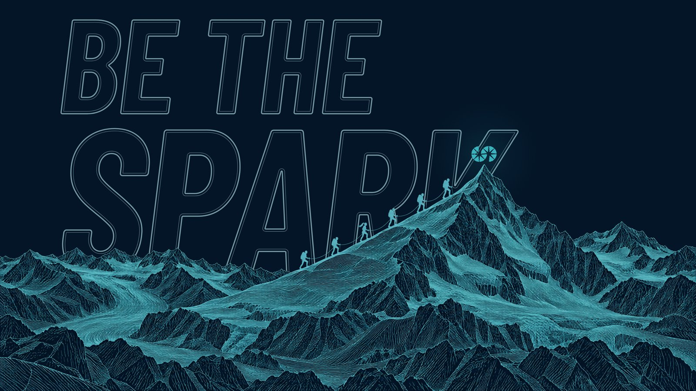

# SF Be the Spark

An [Omarchy](https://omarchy.org/) theme built around the SparkFabrik "Be the Spark" artwork. Six climbers roped together on an engraved alpine ridge climb toward a summit lit by the SparkFabrik symbol, with BE THE SPARK set in outline letters across the sky.



The desktop uses the SparkFabrik palette on deep navy, with Spark Aquamarine as the accent to match the wallpapers.

Requires **Omarchy 4**. The theme ships only `colors.toml` for its colors, so the terminal, the Omarchy shell (bar, notifications, launcher, lock screen), Hyprland borders, Neovim, VS Code, btop and the other themed apps are all generated from the same palette.

## Install

```bash
omarchy theme install https://github.com/stefanomainardi/sf-be-the-spark
```

The theme is cloned into `~/.config/omarchy/themes/sf-be-the-spark` and applied. To switch back to it later, run `omarchy theme set sf-be-the-spark` or pick it from the theme menu.

To update:

```bash
omarchy theme update
```

## Backgrounds

Three moods of the same scene. Cycle them with `omarchy theme bg next` or pick one from the background switcher.

| File                         | Mood                                    |
| ---------------------------- | --------------------------------------- |
| `1-be-the-spark-alba.jpg`    | Alba: cream engraving on navy (default) |
| `2-be-the-spark-rilievo.jpg` | Rilievo: aquamarine line work           |
| `3-be-the-spark-retro.jpg`   | Retro: yellow and orange screen print   |





The lettering has the same size and position in all three moods, so it stays in place when you switch backgrounds.

### Other screen ratios

The default backgrounds are 3440x1440, framed for 21:9 ultrawide displays. Omarchy scales the image to fill the screen, so on a 16:9 or 16:10 display the sides are cropped and part of the lettering is lost.

`backgrounds-extra/` has versions composed for those screens, with BE THE above SPARK:

| Folder                     | Size      | For                              |
| -------------------------- | --------- | -------------------------------- |
| `backgrounds-extra/16x9/`  | 3840x2160 | 16:9 displays (1080p, 1440p, 4K) |
| `backgrounds-extra/16x10/` | 3840x2400 | 16:10 displays and laptops       |



To use them, copy a set into your own background folder for this theme and set one:

```bash
mkdir -p ~/.config/omarchy/backgrounds/sf-be-the-spark
cp ~/.config/omarchy/themes/sf-be-the-spark/backgrounds-extra/16x9/*.jpg \
   ~/.config/omarchy/backgrounds/sf-be-the-spark/
omarchy theme bg set ~/.config/omarchy/backgrounds/sf-be-the-spark/1-be-the-spark-alba-16x9.jpg
```

Files in that folder join the same cycle as the 21:9 ones and survive theme updates.

## Boot and unlock screen

The theme ships the SparkFabrik logo for the Plymouth boot screen (`unlock.png`). Apply it with:

```bash
omarchy plymouth set by theme sf-be-the-spark
```

The theme also appears in the unlock screen picker (`omarchy plymouth switcher`).

## Screensaver

The theme carries the SparkFabrik logo as screensaver art in `screensaver.txt`. Omarchy reads its screensaver art from one global file, so the theme includes a small `theme-set` hook that ties the art to the active theme. With the hook installed, this theme shows the Spark logo and other themes get the stock Omarchy logo back.

Install the hook once:

```bash
mkdir -p ~/.config/omarchy/hooks/theme-set.d
cp ~/.config/omarchy/themes/sf-be-the-spark/hooks/theme-set.d/screensaver-branding \
   ~/.config/omarchy/hooks/theme-set.d/
omarchy theme set sf-be-the-spark
```

Test it with `omarchy-launch-screensaver force` and press any key to dismiss it. If you already installed the same hook for the [Spark Omarchy](https://github.com/stefanomainardi/spark-omarchy) theme, you do not need to install it again.

## Palette

| Role                   | Hex       | Name              |
| ---------------------- | --------- | ----------------- |
| Background             | `#031527` | Spark Black       |
| Foreground             | `#ffffff` | Spark White       |
| Accent, active borders | `#40c6cf` | Spark Aquamarine  |
| Selection              | `#027aca` | Spark Light Blue  |
| Muted                  | `#0c335a` | Spark Blue        |
| Red                    | `#eb0000` | Spark Red         |
| Orange                 | `#f36931` | Spark Orange      |
| Yellow                 | `#f7ad2c` | Spark Yellow      |
| Green                  | `#008844` | Spark Dark Green  |
| Bright green           | `#68d366` | Spark Lime        |
| Magenta                | `#8d1971` | Spark Dark Purple |
| Bright magenta         | `#cd0089` | Spark Purple      |

Selection uses Light Blue rather than Aquamarine so that white text stays readable on it.

## What is in here

| File                 | Role                                                                              |
| -------------------- | --------------------------------------------------------------------------------- |
| `colors.toml`        | The palette. Every generated app config comes from this file                      |
| `shell.lock.toml`    | Lock screen colors, overriding the `[lock]` section of the generated shell config |
| `icons.theme`        | GTK icon theme (`Yaru-prussiangreen`)                                             |
| `keyboard.rgb`       | Backlight color for supported keyboards                                           |
| `preview.jpg`        | Thumbnail in the theme switcher                                                   |
| `unlock.png`         | Logo for the Plymouth boot screen                                                 |
| `preview-unlock.png` | Thumbnail in the unlock screen picker                                             |
| `screensaver.txt`    | Screensaver art                                                                   |
| `backgrounds/`       | 21:9 wallpapers                                                                   |
| `backgrounds-extra/` | 16:9 and 16:10 wallpapers, not in the default cycle                               |
| `hooks/theme-set.d/` | Optional hook that ties the screensaver art to the active theme                   |
| `docs/`              | Images for this README                                                            |

To change a color, edit `colors.toml` and run `omarchy theme set sf-be-the-spark`. Keep comments in `colors.toml` on their own line: Omawrite, the editor Omarchy ships, reads the file line by line and does not strip a trailing comment.

## Credits

Theme by Stefano Mainardi, built on the SparkFabrik design system. It shares its palette and branding with [Spark Omarchy](https://github.com/stefanomainardi/spark-omarchy).

## License

The theme code and configuration are MIT licensed, see [LICENSE](LICENSE).

The SparkFabrik name, logo, the "Be the Spark" artwork and the wallpapers are property of SparkFabrik S.r.l. and are included here with permission. They are **not** covered by the MIT license and may not be reused to identify another product or organization. See [NOTICE](NOTICE).
